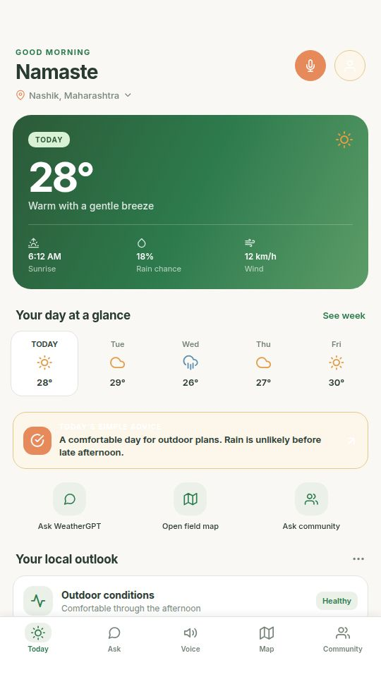
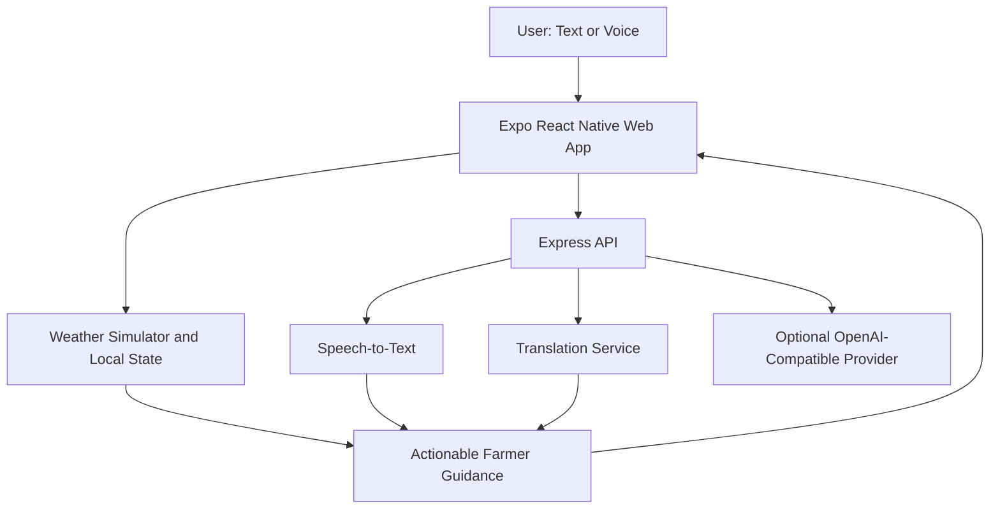

# 🌦️ WeatherGPT — AI-Powered Hyperlocal Weather Intelligence for Bharat 🇮🇳
Live Link :- https://me-l.co/9h326h7r


> **A multilingual, voice-first weather companion that turns complex forecasts into clear and actionable guidance for Indian farmers.**

---

## 📌 Executive Summary

WeatherGPT is a prototype weather and agricultural advisory platform built for **Smart India Hackathon PS ID: 26068** under the **Ministry of Earth Sciences (MoES) / IMD**.

The app brings weather information, crop guidance, conversational help, location selection, and farmer community support into one mobile-first experience.

### ❗ Problem vs ✅ Solution

| ❗ Problem | ✅ WeatherGPT Solution |
|----------|----------------------|
| Weather forecasts are too technical | Converts weather conditions into plain-language field guidance |
| Language barriers limit rural access | Provides a multilingual interface with 25 supported languages |
| Farmers need location-specific advice | Includes Indian state, district, and city weather selection |
| Critical guidance is scattered across apps | Combines forecast, voice, chat, map, and community experiences |
| Users need to remember daily field tasks | Includes farm profile, daily checks, and progress tracking |

---

## 📱 Preview

<p align="center">
  
</p>

---

## 🚀 Key Features

### 🗣️ Multilingual Voice Experience
- Voice briefing and speech-to-text controls
- 25-language catalog including Hindi, Marathi, Bengali, Tamil, Odia, and Punjabi
- Optional speech and translation integration through an OpenAI-compatible service

### 🌾 Agricultural Field Guidance
- Plain-language weather summaries
- Crop-specific advice
- Daily field checklist
- Farm profile with crop and acreage information
- 5-day and 7-day forecast views

### 💬 Conversational Weather Assistant
- Quick questions for rainfall, wind, spraying, irrigation, and harvesting
- Context-aware mock responses for the prototype
- Text and microphone input
- Spoken responses through the device speech engine

### 🗺️ India Weather Simulator
- State, district, and city selection
- Interactive India map
- Rain, wind, and field map layers
- Location-specific temperature, humidity, rain, wind, and recommendations

### 👩‍🌾 Farmer Community
- Share community posts
- Like and translate posts
- Add field photos
- Respectful-language assistance
- Posts and profile progress stored locally on the device

### 📡 Offline-Friendly Prototype
- Core experience works without account setup
- Community posts and daily progress are stored using local device storage
- Live speech features fall back safely when unavailable

---

## 🏗️ System Architecture



### Tech Stack

- **Frontend:** Expo SDK 57, React Native 0.86, React Native Web, Expo Router
- **Language:** TypeScript
- **API:** Express.js with OpenAPI-generated React client
- **Storage:** AsyncStorage for local demo data
- **Maps:** React Native SVG India state map
- **Voice:** Expo Audio, Expo Speech, and optional server transcription
- **Build:** pnpm workspaces

---

## 🧪 Demo Data Notice

> [!IMPORTANT]
> The current repository is a working prototype. Weather values and location forecasts are interactive simulation data, not a claim of live forecast accuracy. A production deployment should connect verified IMD or other authorized providers, GRIB/NWP processing, WIS2.0 alert streams, and secure backend services.

---

## 🛠️ Run Locally

### Requirements

- Node.js 20 or newer
- pnpm 10 or newer
- Expo Go for mobile testing, or a modern browser for web

### Installation

```powershell
corepack enable
corepack pnpm install
```

### Start the Web App

```powershell
corepack pnpm dev:web
```

Open `http://localhost:8081`.

### Start the Expo App

```powershell
corepack pnpm dev
```

Scan the QR code with Expo Go.

### Validation

```powershell
corepack pnpm typecheck
corepack pnpm build
```

The production web build is written to `artifacts/weathergpt-farmers/dist`.

---

## 🔐 Environment Configuration

Optional API settings are documented in [`.env.example`](.env.example).

- `EXPO_PUBLIC_DOMAIN` — API host used by the Expo app
- `PORT` — Express API port
- `DATABASE_URL` — optional PostgreSQL connection
- `AI_INTEGRATIONS_OPENAI_API_KEY` — optional provider key
- `AI_INTEGRATIONS_OPENAI_BASE_URL` — optional provider base URL

Never commit real API keys or credentials.

---

## 📂 Project Structure

- `artifacts/weathergpt-farmers` — Expo mobile and web application
- `artifacts/api-server` — Express API
- `lib/api-spec` — OpenAPI specification
- `lib/api-client-react` — generated React API client
- `lib/db` — Drizzle database schema
- `screenshots` — app preview assets
- `.github/workflows/ci.yml` — automated type-check and web build

---

## 🔮 Future Scope

- Live IMD and WIS2.0/NWP weather ingestion
- Verified disaster alert geofencing
- Regional voice recognition and offline audio caching
- Crop image analysis
- Secure user accounts and cloud-synchronized community posts
- Android and iOS store deployment
- Global weather and climate integration

---

## 📄 License

MIT. See [LICENSE](LICENSE).
