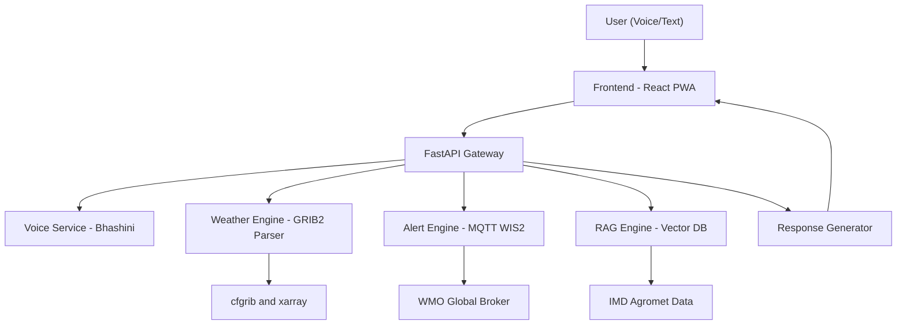

# 🌦️ WeatherGPT — AI-Powered Hyperlocal Weather Intelligence for Bharat 🇮🇳

> **Bringing trusted, multilingual, hyperlocal weather intelligence to every citizen — even offline.**

---

## 📌 Executive Summary

WeatherGPT is an **AI-driven disaster intelligence platform** built for the **Smart India Hackathon (PS ID: 26068)** under the **Ministry of Earth Sciences (MoES) / IMD**.

It bridges the gap between **complex meteorological data** and **real-world decision-making**, especially for **rural communities and farmers**.

### ❗ Problem vs ✅ Solution

| ❗ Problem | ✅ WeatherGPT Solution |
|----------|----------------------|
| Weather forecasts are too technical | Converts into **actionable insights** (e.g., farming decisions) |
| Language barriers in rural India | **Voice-first multilingual interface** via Bhashini |
| Inaccurate AI hallucinated forecasts | Direct ingestion of **GRIB2 NWP data (GFS/WRF)** |
| Delayed disaster alerts | Real-time **WIS2.0 MQTT alert streaming** |
| Poor internet connectivity | **Offline-first audio caching & fallback APIs** |

---

## 🚀 Key Features

### 🗣️ Rural Voice & Multilingual Module
- Speech-to-text + text-to-speech via **Bhashini API**
- Supports **regional dialects + translations**
- Works even on **low bandwidth (2G/3G)**

### 🌐 Direct NWP Model Ingestion
- Parses **GRIB2 weather files** (GFS / WRF)
- Uses `cfgrib` + `xarray`
- Eliminates hallucination → **100% data-grounded forecasts**

### 🚨 Real-Time Disaster Alerts (WIS2.0)
- MQTT-based ingestion from **WMO Global Broker**
- Push notifications with **geofencing**
- Early warning system for floods, storms, cyclones

### 🌾 Actionable Agricultural Advisory
- Converts weather → **real farming actions**
- Example:
  - *80mm rainfall → Flood risk → Delay fertilizer*
- Based on IMD Agromet bulletins (RAG powered)

### 🗺️ GIS Telemetry Map & Diagnostics
- Interactive maps using **Leaflet / Mapbox**
- Radar heatmaps + weather layers
- Upload crop images → **AI damage analysis**

### 📡 Offline-First Resilience
- Audio caching for repeat queries
- Fallback layers when:
  - Bhashini unavailable
  - Translation APIs down
- Designed for **rural connectivity realities**

---

## 🏗️ System Architecture

